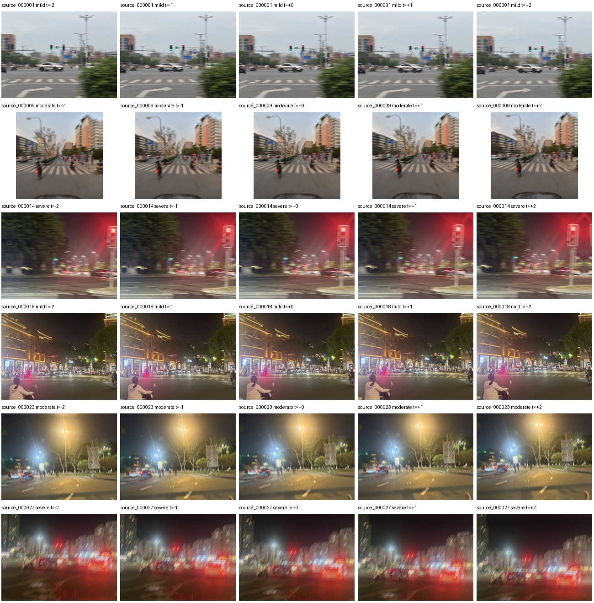

# KGTSR Synthetic Motion Sequences v1.0.0

This blurred-only dataset contains **1,620 blurred images** derived from a prioritized subset of author-provided still photographs. Each unique source contributes 12 motion variants: four mild, four moderate and four severe.



## Download

Full images and metadata are provided as checksummed ZIP parts in [dataset-v1.0.0](https://github.com/shenzexin/KG-TSRDeblur/releases/tag/dataset-v1.0.0). All parts extract into the same `KGTSR-SyntheticMotion-v1.0.0` directory.

From the repository root:

```bash
python datasets/kgtsr_synthetic_motion/download.py --output data
python datasets/kgtsr_synthetic_motion/reader.py --root data/KGTSR-SyntheticMotion-v1.0.0 --split test
```

The downloader verifies each archive's SHA-256 before extraction. Alternatively, download every ZIP part from the release page, verify against `SHA256SUMS.txt` and extract all parts into one parent directory.

## Contents

```text
KGTSR-SyntheticMotion-v1.0.0/
  dataset.json
  generation_config.json
  sources.jsonl
  source_aliases.json
  sequences.jsonl
  frames.jsonl
  triplets.csv
  train.jsonl
  val.jsonl
  test.jsonl
  frame_checksums.sha256
  README.md
  DATA_LICENSE.txt
  preview.jpg
  sequences/
    train/source_000001_v00/frame_000.jpg
    train/source_000001_v00/frame_001.jpg
    train/source_000001_v00/frame_002.jpg
    train/source_000001_v00/frame_003.jpg
    train/source_000001_v00/frame_004.jpg
    ...
```

Every sequence is ordered as `t-2, t-1, t, t+1, t+2`. The center is `frame_002.jpg`; its immediate previous/next frames are `frame_001.jpg` and `frame_003.jpg`. The nominal simulated frame interval is 1/30 second. Each sequence JSON record includes the five paths, center triplet, split, motion parameters, exposure duration, severity and seed. The frame manifest includes displacement, dimensions and image checksums.

## Partitions

| Partition | Sequences | Blurred frames |
| --- | ---: | ---: |
| Train | 276 | 1,380 |
| Validation | 12 | 60 |
| Test | 36 | 180 |
| Total | 324 | 1,620 |

Sources were grouped into 11 conservative visual-scene groups, supplemented by perceptual near-duplicate grouping. Groups were assigned with seed 42 to approximately 70/10/20 **by group count**; unequal group sizes lead to the counts above. All variants and frames from each source/scene group remain in the same partition. These partitions describe this release, not recovered original video identities.

## Image formation

The private still is oriented according to EXIF, converted to RGB and resized to a maximum long side of 1,024 pixels. A seeded image-plane translation follows `d(t) = v*t + 0.5*a*t^2`, where time is measured in frame intervals. For each frame, 129 midpoint exposure samples define a subpixel trajectory. Bilinear mass assignment produces a normalized correlation kernel; integration is performed in linear light, followed by translation, sRGB conversion and JPEG encoding at quality 94. Reflection padding prevents black translation borders. Exported JPEGs do not retain source EXIF.

Mild, moderate and severe variants use different velocity/exposure ranges. This is a deterministic image-formation simulation; it does not recover the original camera trajectory or reconstruct true occlusions/parallax from a single photograph. Parameters are available in the sequence manifest and implementation.

## Use with KG-TSRDeblur

Load the ordered frames with `reader.py` and process them through the existing detector/tracker/ROI pipeline. Only current and earlier observations should enter a frame's motion prior; future frames may be used for visualization but not as causal inputs. The simulated global displacement is metadata, not a traffic-sign detection or Kalman posterior.

No traffic-sign boxes, class labels, tracked sign identities, detector outputs or clear targets are included. Recognition metrics need separate annotations, and paired restoration training/PSNR/SSIM need private aligned reference targets. Do not use the blurred frame itself as a clear target.

## Rebuild from private sources

```bash
python -m pip install numpy==2.2.6 Pillow==12.3.0 opencv-python-headless==4.11.0.86
python tools/build_motion_dataset.py --source /path/to/private/photos --output data/KGTSR-SyntheticMotion-v1.0.0 --priority-only --priority-variants 12 --seed 42 --workers 4
```

The builder writes blurred frames and metadata only. Source photographs remain outside the output folder. Review [DATA_LICENSE.txt](DATA_LICENSE.txt) before reusing image data. Repository software licensing and image-data rights are separate.
